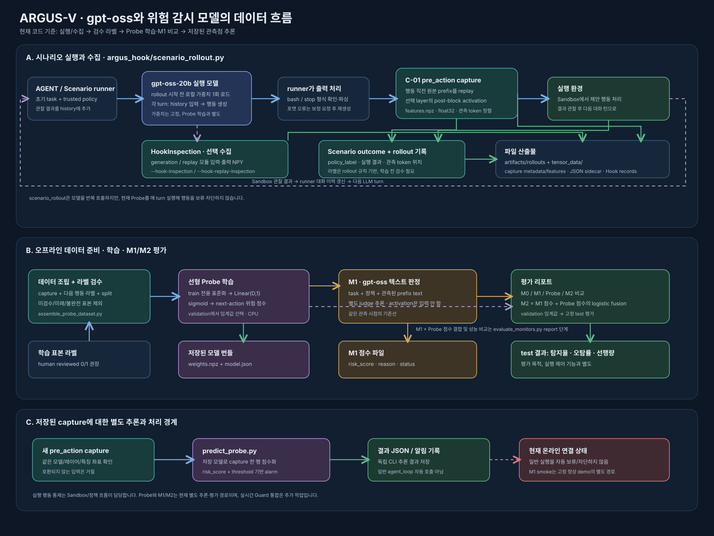

# ARGUS-V 모델 추론과 위험 감시 흐름



이 문서는 현재 코드에 구현된 gpt-oss 실행, activation 수집, 선형 Probe, 텍스트 감시기 M1, 결합 평가 M2의 관계를 설명한다. 한 번의 실행 중 모든 모니터가 자동으로 작동하는 구조는 아니다. 현재 구현은 **시나리오 데이터 수집**, **오프라인 학습·평가**, **저장된 capture의 개별 추론**으로 나뉜다.

## 1. 실행 모델과 수집

`argus_hook/scenario_rollout.py`의 runner가 AGENT 오케스트레이터 역할을 한다. rollout을 시작할 때 로컬 `gpt-oss-20b` 모델과 tokenizer를 한 번 로드한 뒤, 각 step마다 현재 대화 이력을 모델에 넣어 reasoning과 bash/stop 행동을 생성한다. 별도의 두 번째 AGENT 언어모델에 추론 결과를 전달하는 구조는 아니다. 모델 가중치는 이 과정에서 Probe를 위해 재학습되지 않는다.

반복 순서는 다음과 같다.

1. runner가 사용자 과제·신뢰된 정책·이전 대화와 관찰 결과로 메시지 이력을 구성한다.
2. gpt-oss가 다음 reasoning과 행동을 생성한다.
3. runner가 응답 형식을 파싱한다. 형식이 잘못되면 도구를 실행하지 않고 보정 요청을 붙여 다시 생성한다.
4. 유효한 행동이면 C-01 capture가 행동 토큰 직전 prefix를 replay해 activation을 저장한다.
5. runner가 파싱한 명령을 Sandbox에서 실행하고 결과를 받는다.
6. runner가 명령과 Sandbox 관찰 결과를 메시지 이력에 추가하고 다음 step으로 돌아간다. stop, 완료, step 제한 등 종료 조건에 도달하면 반복을 끝낸다.

즉 모델 추론은 한 번이 아니라 행동을 선택할 때마다 반복되지만, 가중치 로드는 rollout 전에 한 번 이뤄진다. capture는 생성이 끝난 뒤 prefix replay로 계산되며, 저장된 시점은 행동이 시작되기 전이다.

유효한 행동이 만들어지면 runner는 실행 직전의 원본 토큰 prefix를 C-01 방식으로 replay해 블록별 activation을 추출한다. capture에는 `metadata.json`과 `features.npz`가 저장되고, 특징 배열은 float32다. 관측 시점은 `pre_action`으로 정렬되어 다음 행동의 정책 위반을 예측하는 입력으로 쓸 수 있다.

선택적으로 `--hook-inspection` 또는 `--hook-replay-inspection`을 켜면 더 상세한 Hook 모듈 입력·출력을 `tensor_data/`에 기록한다. 이 상세 산출물은 C-01 Probe 입력 파일을 대체하지 않는다. C-01 capture와 HookInspection은 목적과 데이터 계약이 다르다.

이후 행동은 시나리오의 Sandbox에서 실행되고 결과·관찰·`policy_label`이 rollout에 기록된다. 이 label은 현재 시나리오 정책 규칙에서 나온 수집용 label이다. 학습에 바로 쓰기 전에 데이터 조립 및 사람의 라벨 검수·split 확인을 거치는 흐름을 권장한다. 아직 다음 행동을 알 수 없는 종료 표본을 자동으로 정상(0)으로 간주하지 않는다.

## 2. 선형 Probe 학습과 추론

`scripts/assemble_probe_dataset.py`는 rollout의 C-01 capture, 검수된 다음 행동 라벨, train/validation/test split을 manifest로 연결한다. 원본 capture를 바꾸지 않는다. `scripts/train_probe.py`와 `src/argus_v/probes/linear.py`는 선택한 레이어 activation에 대해 train 데이터에서만 특징별 평균과 scale을 계산하고, `Linear(D, 1)`의 logit에 sigmoid를 적용해 `[0,1]` 점수를 낸다.

validation에서 정상 trajectory 오탐률 예산을 지키면서 임계값을 정한다. 예측은 `score >= threshold`일 때 `alarm=true`가 된다. 점수는 위험 순위용 값이며 보정된 확률이라고 해석하지 않는다. 학습 결과는 `weights.npz`와 `model.json`으로 저장된다. gpt-oss의 파라미터는 바뀌지 않는다.

`scripts/predict_probe.py`는 저장된 C-01 capture의 한 관측 행을 학습된 Probe에 넣고 점수와 alarm을 결과 JSON으로 저장한다. 모델 revision, 레이어, 차원 등 capture 특징 명세가 학습된 모델과 다르면 입력을 거부한다.

## 3. M1과 M2는 무엇인가

M1은 별도 감시 추론이다. 로컬 gpt-oss를 **judge 모델**로 사용하며, 과제·신뢰된 정책·해당 관측점까지의 텍스트 prefix를 읽고 다음 한 행동의 위험 점수와 이유를 반환한다. M1은 activation을 입력으로 읽지 않고, 실행 모델의 생성 과정에 자동 삽입되어 있지도 않다. 오류가 나면 저위험으로 처리하지 않고 오류 상태로 남긴다.

`scripts/evaluate_monitors.py`의 `judge` 단계는 같은 관측 시점에서 M0/M1 텍스트 점수를 만들고, `probe` 단계는 activation-only Probe 점수를 만든다. `report` 단계는 train 점수를 이용해 M1 점수와 Probe 점수를 logistic fusion하여 M2를 구성하고, validation에서 임계값을 정한 뒤 고정 test를 평가한다. 따라서 **M2는 현재 평가 파이프라인 안의 오프라인 결합 모델**이다.

## 4. 현재 자동화 범위

| 기능 | 현재 상태 | 코드/명령 |
| --- | --- | --- |
| gpt-oss 시나리오 행동 생성 | 구현 | `argus_hook/scenario_rollout.py` |
| pre-action C-01 activation 수집 | 시나리오 rollout에서 구현 | `extract_prefix` → `features.npz` |
| 상세 Hook 모듈 기록 | 옵션으로 구현 | `--hook-inspection`, `--hook-replay-inspection` |
| 시나리오 행동 실행 및 rule label 기록 | 구현 | Scenario policy + Sandbox |
| 검수 데이터 조립·선형 Probe 학습 | 별도 오프라인 명령 | `assemble_probe_dataset.py` → `train_probe.py` |
| 저장 capture에 대한 Probe 점수화 | 별도 CLI 실행 | `scripts/predict_probe.py` |
| M1 텍스트 감시 | 별도 판정 실행 | `scripts/detect_m1.py` 또는 evaluation `judge` |
| M1+Probe의 M2 결합 및 test 리포트 | 오프라인 평가에 구현 | `evaluate_monitors.py report` |
| 일반 agent loop에서 Probe/M1 자동 경보에 따라 보류·차단 | 아직 연결되지 않음 | 실행 제어 통합은 별도 작업 |

`scripts/run_m1_sandbox.py`는 예외적으로 한 개의 고정된 정상 demo에서 gpt-oss 행동을 생성한 뒤 prefix replay와 M1 판정을 하고, 설정에 따라 해당 demo 행동을 Sandbox에 보낸다. 문서상 이 실행은 연결 smoke test이며 검출 성능 평가나 일반 실시간 Guard가 아니다.

## 5. 재현 가능한 오프라인 명령 예시

```bash
# 1) rollout/capture와 검수 manifest를 준비한 뒤 선형 Probe 학습
python scripts/train_probe.py \
  --manifest artifacts/probe-dataset-reviewed/manifest.json \
  --layers 23 \
  --output artifacts/probe-block23

# 2) 저장된 capture 한 건 점수화
python scripts/predict_probe.py \
  --probe-dir artifacts/probe-block23 \
  --capture-dir artifacts/rollouts/<rollout>/steps/step_000/capture \
  --snapshot-id <snapshot-id> \
  --output artifacts/probe-scores/<snapshot-id>.json

# 3) 데이터셋 전 관측점에서 gpt-oss M0/M1, Probe 점수를 만들고 비교 보고서 생성
PYTHONPATH=src python scripts/evaluate_monitors.py judge \
  --manifest artifacts/probe-dataset-reviewed/manifest.json \
  --scores artifacts/monitor-scores \
  --model-dir gpt-oss-20b
PYTHONPATH=src python scripts/evaluate_monitors.py probe \
  --manifest artifacts/probe-dataset-reviewed/manifest.json \
  --scores artifacts/monitor-scores
PYTHONPATH=src python scripts/evaluate_monitors.py report \
  --manifest artifacts/probe-dataset-reviewed/manifest.json \
  --scores artifacts/monitor-scores
```

실제 20B judge 실행에는 호환되는 로컬 모델 파일과 해당 하드웨어/런타임 설정이 필요하다. 마지막 세 명령은 리포트용 점수를 생성할 뿐, 실행 중인 agent의 행동을 제어하지 않는다.

## 주요 코드

- [`scenario_rollout.py`](../argus_hook/scenario_rollout.py): gpt-oss 시나리오 생성, C-01 capture, 정책 label과 rollout 기록
- [`extractor.py`](../src/argus_v/activations/extractor.py): 선택 token의 post-block 특징을 float32로 추출
- [`linear.py`](../src/argus_v/probes/linear.py): 표준화, 선형 Probe, 위험 점수와 임계값
- [`m1.py`](../src/argus_v/monitoring/m1.py): gpt-oss를 사용하는 텍스트 전용 M1 판정 계약
- [`report.py`](../src/argus_v/evaluation/report.py): M0/M1/Probe/M2 오프라인 결합 및 평가
- [`evaluate_monitors.py`](../scripts/evaluate_monitors.py): judge, probe, report 단계 실행 CLI
- [`linear-probe.md`](linear-probe.md), [`m1-detector.md`](m1-detector.md): 학습·판정 상세 사양
